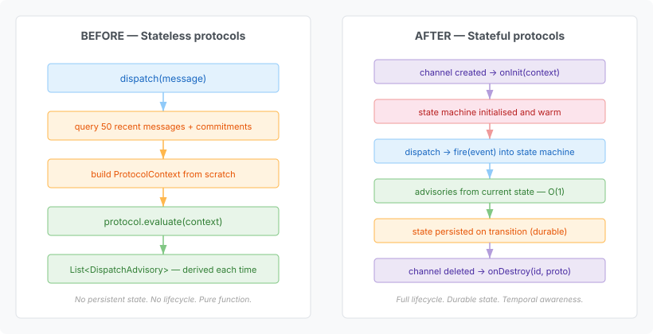
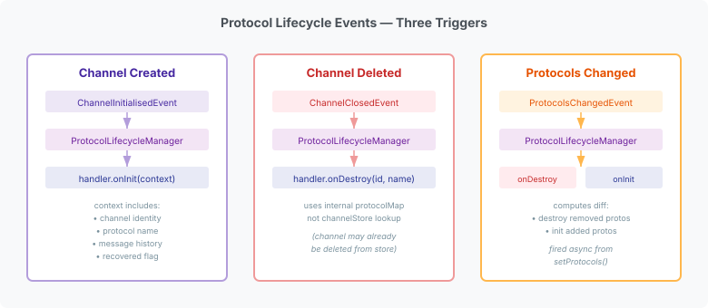

Qhorus has had channel protocols since July — `REQUEST_RESPONSE`, `TASK_COMPLETION`, `ROUND_ROBIN`, `CONTRIBUTION_REQUIRED`. Each one evaluates a channel's recent message history and returns advisories: "three unanswered queries, consider waiting" or "agent-a has sent five consecutive messages without contributions from anyone else."

They work. But they're stateless. Every time a message arrives, the protocol re-derives its understanding from a bounded lookback window — the last 50 messages and whatever commitments are currently open. It's a pure function: same inputs, same outputs, no memory between calls.

That's fine for counting things. It is not fine for temporal coordination.

## What stateless can't do

Consider an escalation protocol: if a COMMAND hasn't been acknowledged within five minutes, nudge the obligor. If still no response after fifteen minutes, escalate to a supervisor. After thirty minutes with no action, quarantine the channel.

A stateless protocol can't track that. It sees a snapshot — 50 messages — and has no notion of elapsed time between evaluations. It doesn't know whether it already nudged five seconds ago or hasn't nudged at all. It has no memory of what state it was in before this dispatch call.

The platform's playbook engine has exactly the primitives this needs: `timed-absence` detects expected events that haven't arrived within a window. `quorum` tracks N-of-M completion across participants. The Serverless Workflow runtime persists state across restarts. Platform already built the [evaluation bridge](https://github.com/casehubio/platform/issues/661) — a `PlaybookProtocolEvaluator` that maintains per-channel state machine instances, fires message-type events into them, reads advisories from the current state, and persists transitions through `CoordinationStateStore`.

The bridge exists. But qhorus had no way to tell it when a channel was born, when it died, or when its protocols changed at runtime. The state machines were lazily created on first `evaluate()` call — no eager init, no cleanup on delete, no recovery on restart, no notification when `setProtocols()` changed the list. The infrastructure gap was the lifecycle.

## What we built



The `ChannelProtocol` SPI didn't change. That was a hard constraint — the dispatch pipeline doesn't care whether a protocol derives its advisories from message history or from an internal state machine. Both return `List<DispatchAdvisory>`. The lifecycle is invisible to the caller.

What changed is the infrastructure around it. A new SPI — `ProtocolLifecycleHandler` — lets a consumer declare which protocols it manages and receive init/destroy callbacks:

```java
public interface ProtocolLifecycleHandler {
    boolean supports(String protocolName);
    void onInit(ProtocolLifecycleContext context);
    void onDestroy(UUID channelId, String protocolName);
}
```

The `supports()` predicate means one CDI bean can handle all playbook-backed protocols. The platform's `PlaybookProtocolEvaluator` doesn't need a separate handler per protocol — it claims any protocol name it has a compiled state machine for.

`onInit` receives a self-contained context: channel identity, protocol name, participants, the full channel message history, and a `recovered` flag that distinguishes startup recovery from fresh creation. The handler decides its own recovery strategy — restore from durable state if the Serverless Workflow backend has it, or replay messages through the state machine if not. Qhorus provides the data; the handler makes the judgment call.

## Three triggers



A `ProtocolLifecycleManager` sits between the CDI events and the handlers. It observes three things:

**Channel creation** fires `ChannelInitialisedEvent` — the same event that backends already observe for gateway registration. The manager looks up the channel's protocol list, finds supporting handlers, calls `onInit` for each. On application restart, the same event fires with `recovered=true` for every persisted channel — state machines are restored before the first message arrives.

**Channel deletion** fires `ChannelClosedEvent`. Here we hit the first real design problem: `ChannelService.delete()` never called `channelGateway.closeChannel()`. The channel was removed from the store, but no lifecycle event fired. Backends weren't closed. Handlers weren't notified. State leaked silently.

The fix was straightforward — call `closeChannel()` before `channelStore.delete()` — but the ordering exposed a subtler issue. By the time the `ChannelClosedEvent` fires, the channel might already be gone from the store. The manager can't look up its protocol list. So it maintains an internal `ConcurrentHashMap<UUID, List<String>>` — populated during init, consumed during destroy. The destroy path never touches the store.

**Runtime protocol changes** fire a new `ChannelProtocolsChangedEvent` from `setProtocols()`. When a channel's protocol list changes from `[REQUEST_RESPONSE, TASK_COMPLETION]` to `[REQUEST_RESPONSE, ESCALATION_MONITOR]`, the manager computes the diff — destroys `TASK_COMPLETION`, inits `ESCALATION_MONITOR` with the channel's current message history. The transition is atomic from the handler's perspective.

## Why the `supports()` predicate

I considered a name-keyed registry — one handler per protocol name, like `ProtocolRegistry` does for `ChannelProtocol` beans. Simpler dispatch, compile-time uniqueness guarantees.

But the platform bridge is a single CDI bean that handles all playbook-backed protocols. A name-keyed registry would force it to create synthetic per-protocol handler instances — wrapper classes with no purpose except satisfying a registration contract. The `supports()` predicate lets one bean claim everything it knows about, which is how the bridge actually works. `PlaybookProtocolEvaluator` has a `ConcurrentHashMap<ProtocolInstanceKey, ProtocolInstance>` — one handler, many protocol names, many channel instances.

The linear scan through handlers on each lifecycle call is a non-issue. Lifecycle calls happen on channel create, delete, and protocol reconfiguration — not on every dispatch. The handler set is typically one bean (the platform bridge) or zero (when no playbook protocols are in use).

## What this opens up

Temporal coordination is the immediate unlock. An escalation protocol can now track a multi-stage timer across restarts. A negotiation protocol can enforce turn-taking with deadlines — "propose within 10 minutes or the offer expires" — where the deadline is managed by the state machine, not derived from message timestamps.

But the mechanism is general. Any protocol that needs to accumulate state across dispatches — learning protocols that adjust thresholds based on observed patterns, compliance protocols that track cumulative violations, coordination protocols that enforce multi-phase workflows — can now use durable state without the dispatch pipeline knowing about it.

The `ChannelProtocol` SPI stays the same. The handler manages the state. The infrastructure manages the handler. Each layer knows only what it needs to.

Consumer-defined governance rules in YAML — without writing Java, without touching the dispatch pipeline, with durable state that survives restarts and temporal primitives that track what hasn't happened yet. That's what the [Phase 2 epic](https://github.com/casehubio/casehub-ops/issues/201) is building toward. The lifecycle hooks are the piece that makes per-channel state machines possible.
