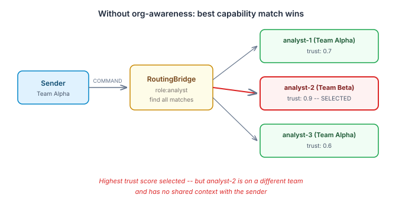
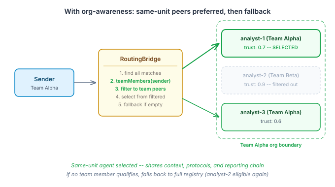

# The Team You Know

Most multi-agent routing is capability matching. An agent sends a COMMAND with `target: "role:analyst"`, the router finds every agent tagged with the `analyst` capability, picks the one with the highest trust score, and dispatches. Simple. Correct. And completely blind to organisational structure.

In a system with three analysts, the router will always pick the one with the best score — even if that agent is in a different department, working under different protocols, reporting into a different chain. The sender and the selected agent share a capability tag. They may share nothing else.

This matters more than it looks. When agents share an organisational unit, they share context: the same communication norms, the same reporting expectations, the same institutional knowledge about what "done" means in their corner of the system. An analyst on your team already knows how your team's channels work. An analyst from another team might be technically better but operationally foreign.



Human organisations learned this centuries ago. You don't send work to the best person in the company. You send it to the best person in your unit, and you escalate to the wider organisation only when nobody local can handle it. Military command structures, hospital departments, engineering squads — the pattern is the same. Prefer local, widen when necessary.

## What we built

Qhorus already has a `RoutingBridge` that resolves `role:X` targets to specific agents. It queries the eidos `AgentRegistry` for capability matches, runs them through an `AgentSelector` for trust-based ranking, and checks capacity and threshold constraints before dispatching. The machinery works well for flat capability matching.

The change is a filter inserted between the registry lookup and the selector. After `agentRegistry.find(byCapability)` returns all matching agents, `RoutingBridge` now calls `OrgAwareDispatch.teamMembers(sender, tenancyId)` — a contract from eidos that returns the IDs of agents in the same organisational unit as the sender. The capability matches are filtered to that set. If any team members have the required capability, only they are passed to the selector. If none do, the full unfiltered list is used instead.



The fallback is the critical design point. Org preference is a soft bias, not a hard constraint. An agent in a unit with no local analyst still gets an analyst — just one from outside the unit. The system degrades to exactly the behaviour it had before. No new failure modes.

The implementation is around 15 lines in `RoutingBridge.resolve()`. The `OrgAwareDispatch` dependency is nullable — when eidos org structures aren't on the classpath, the bridge behaves identically to before. The `RoutingOutcome` records the strategy as `"eidos-org-preferred"` when org filtering applies, `"eidos-simple"` when it doesn't, so the ledger captures which path was taken.

```java
if (orgAwareDispatch != null) {
    List<String> teamMemberIds = orgAwareDispatch.teamMembers(
            dispatch.sender(), tenancyId);
    if (teamMemberIds != null && !teamMemberIds.isEmpty()) {
        var teamSet = new HashSet<>(teamMemberIds);
        List<AgentMatch> teamMatches = matches.stream()
                .filter(m -> teamSet.contains(m.descriptor().agentId()))
                .toList();
        if (!teamMatches.isEmpty()) {
            candidates = teamMatches;
            strategy = "eidos-org-preferred";
        }
    }
}
```

## Why this matters beyond routing

The interesting thing about org-aware routing isn't the code — it's what it implies about how multi-agent systems will need to work as they grow.

Small agent deployments don't need org structure. When you have five agents, everybody knows everybody. But at twenty, fifty, a hundred agents, the flat capability graph stops being useful. You get the same problems human organisations have had forever: the best person for the job is unknown to the requester, context is lost crossing unit boundaries, and global optimisation (pick the highest trust score everywhere) defeats local coherence (keep related work together).

This is the beginning of multi-agent governance reflecting real institutional structure. Not because AI agents have political allegiances — but because the agents that share a reporting chain also share the context, protocols, and domain knowledge that make collaboration efficient. Org structure is a proxy for shared understanding.

The pattern also makes trust scores more meaningful. When an agent's trust score is computed from peers within the same unit, the score reflects performance in a specific operational context. A globally aggregated trust score averages over contexts that may have nothing in common. Org-scoped routing means the trust signal and the routing decision are drawn from the same population.

There's a broader design question that follows from this: should `AgentSelector` itself be org-aware, rather than pre-filtering candidates? I chose pre-filtering because it keeps the change in qhorus with no eidos API changes — but as org-aware behaviour spreads to other platform components, the selector may be the more natural home. For now, the filter works.
