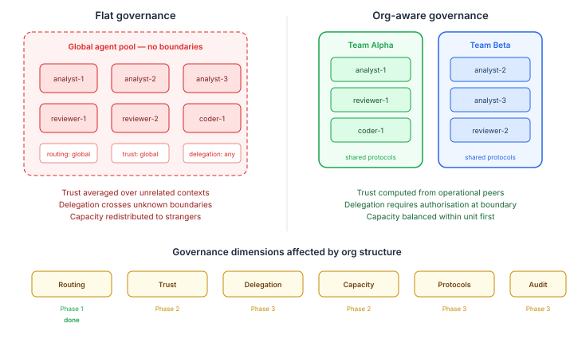
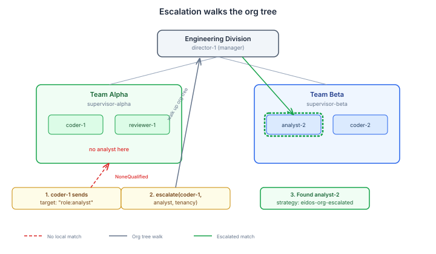
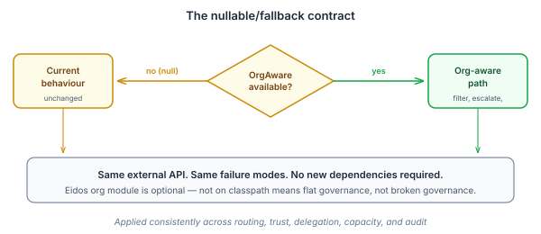

# Governance Follows the Org Chart

There's a pattern in every multi-agent framework I've studied — A2A, AutoGen, LangGraph, CrewAI, Swarm — that treats agents as a flat pool of capabilities. Need an analyst? Query the registry, rank by score, dispatch to the winner. The capability graph is the entire world model.

This works until the system gets big enough to have politics.

I don't mean literal politics. I mean the structural reality that ten agents working in the same domain share context, norms, and expectations that a hundred agents across an organisation do not. When you dispatch work to the highest-scoring agent globally, you're optimising for individual competence at the expense of collective coherence. The agent you chose might be brilliant at analysis. It might also have no idea how your team's channels work, what your reporting obligations are, or what "done" means in your operational context.

Human organisations solved this problem thousands of years ago. Work flows through organisational structure. You send it to someone on your team. If nobody on your team can handle it, you escalate to the next level. You don't send it to the best person in the company — you send it to the best person who shares enough context to do the job without a knowledge transfer.

We just landed four of the six governance dimensions that make Qhorus org-aware. The code is shipping. The implications run deeper than the implementation.

## What's live

[Yesterday's work](/blog/2026-10-30-mdp01-the-team-you-know) landed routing preference — filtering capability matches to same-unit peers before the selector sees them. Today we added escalation, redistribution, and delegation authorisation. Four of six governance dimensions are now org-aware.



### Escalation

The interesting engineering problem isn't routing to the right agent. It's what happens when there is no right agent. In a flat system, `NoneQualified` means failure — throw an exception, tell the caller nobody can help. In an org-aware system, `NoneQualified` means "nobody in the candidate set can help." The candidate set isn't the whole world.

Escalation walks the org tree. When `AgentSelector` returns `NoneQualified` or `Escalated`, the routing bridge now calls `OrgAwareDispatch.escalate(sender, capability, tenancyId)` before giving up. Escalation finds a supervisor's team that has the required capability — the manager's analyst, the director's analyst, however far up the tree you need to go.



The code is deliberately compact:

```java
private RoutingOutcome tryOrgEscalation(String sender, String capability,
                                         String target, String tenancyId) {
    if (orgAwareDispatch == null) return null;
    var escalated = orgAwareDispatch.escalate(sender, capability, tenancyId);
    if (escalated.isEmpty()) return null;
    return new RoutingOutcome(
            escalated.get().descriptor().agentId(),
            target, "eidos-org-escalated", 1, 0.0);
}
```

Both `NoneQualified` and `Escalated` call this before throwing. If escalation finds someone, the outcome is recorded as `"eidos-org-escalated"` — the ledger captures which path was taken, so you can audit how often work leaves its unit of origin and at what level it resolves.

The null check is the contract. No `OrgAwareDispatch` means no org tree to walk, so escalation is skipped and the system falls back to throwing the original exception. Every org-aware feature follows this pattern — present when available, invisible when not.

### Redistribution

When an agent is overloaded and the capacity system redistributes its obligations, redistribution already routes through `RoutingBridge.resolve()`. That call now carries org-awareness from the routing preference work — same-unit agents are tried first automatically. No new code needed, just a verification test to confirm the path.

This is the payoff of building org-awareness into the routing bridge rather than into individual features. Every capability-based dispatch that flows through the bridge inherits org preference. Redistribution didn't need to know about org structure. It just needed to ask for `role:analyst` like it always did, and the bridge handles the rest.

### Delegation authorisation

A HANDOFF message says "I can't do this, someone else should." In a flat system, any agent can delegate to any other. That's fine in a five-agent system. In a fifty-agent system, unconstrained delegation is how work disappears into corners nobody monitors.

The dispatch pipeline now checks whether a HANDOFF's sender is authorised to delegate to the named target. Cross-unit delegation produces an `ORG_DELEGATION` advisory — not a hard block, but a governance signal that enforcement mode can act on.

```java
if (ch != null && dispatch.type() == MessageType.HANDOFF
        && dispatch.target() != null
        && !dispatch.sender().contains(":")) {
    var delegationAllowed = routingBridge.canDelegateTo(
            dispatch.sender(), dispatch.target(), effectiveTenancyId);
    if (delegationAllowed.isPresent() && !delegationAllowed.get()) {
        advisories.add(new DispatchAdvisory("ORG_DELEGATION",
                Severity.WARNING, msg, evidence, SuggestedAction.ESCALATE));
    }
}
```

System senders are exempt — `system:redistribution`, `system:watchdog` operate across units by design. The `sender.contains(":")` check matches the existing `ObligorTrustPolicy` exemption pattern.

The advisory approach is deliberate. In a system where org structure might be partially defined or actively changing, hard-blocking cross-unit delegation would create immediate operational failures. Advisory mode lets the system record that a delegation crossed a boundary, lets enforcement mode decide how seriously to treat it, and lets the organisation tighten the constraint when they're ready. Governance is a dial, not a switch.

## The design principle

Every one of these dimensions follows the same contract: org-aware when the structure is available, flat when it isn't.



The `OrgAwareDispatch` dependency is always nullable. Missing org data means the system behaves exactly as it did before — not that it breaks. This is load-bearing. The eidos org module is an optional dependency. A Quarkus app that adds `casehub-qhorus` without `casehub-eidos` gets the full communication mesh with flat governance. Add eidos, and governance starts respecting institutional boundaries. No code changes, no configuration, no migration.

The alternative — making org structure a hard dependency — would be cleaner architecturally and worse practically. Most deployments start small. Requiring org definitions before the system works at all is a barrier to adoption that provides no value until the system is large enough to need it.

## What this is really about

The multi-agent ecosystem is converging on capability-based routing as the standard pattern. I think that's necessary but not sufficient. Capability tells you what an agent can do. Org structure tells you what an agent should be doing — which is a governance question, not a capability question.

The agents that share a reporting chain also share the context, protocols, and domain knowledge that make collaboration efficient. Org structure isn't bureaucracy imported into software. It's a proxy for shared understanding, and shared understanding is what makes the difference between a collection of capable agents and a coherent system.

Two dimensions remain — org-scoped trust computation and protocol inheritance. Trust is Phase 2 work in the eidos layer, and protocol inheritance depends on the channel config bootstrap getting space-aware. The foundation is there. The pattern is proven. The rest is engineering.
