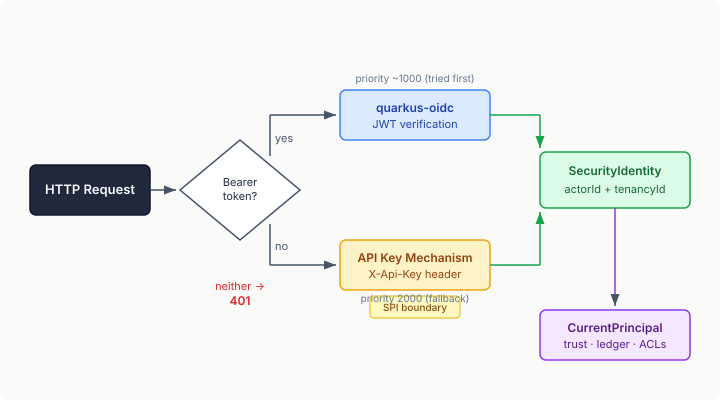

# The Key That Opens the Mesh

Multi-agent systems have an identity problem. When agents communicate over a shared mesh, the infrastructure has to answer a deceptively simple question: *who is talking?*

Without authentication, any process that can reach the mesh endpoint can register agents, send messages, create channels, and read every conversation. That's fine for a local dev loop where the mesh runs on localhost. It's not fine the moment the mesh is reachable over a network — which is the entire point of a distributed mesh service.

## The Shape of the Problem

Qhorus started as an embedded Quarkus library. Authentication was someone else's problem — the host application owned its own HTTP stack, its own identity provider, its own request filters. Qhorus just needed a `CurrentPrincipal` to tell it which tenant was talking, and the host wired that up however it pleased.

The standalone mesh service changed the picture. There's no host application. The mesh IS the application. Every endpoint — REST, MCP-over-SSE, A2A JSON-RPC, WebSocket — is directly exposed. And the existing identity setup was `QhorusInboundCurrentPrincipal`, which returns `"anonymous"` for every caller and reads tenant identity from an unauthenticated `X-Tenancy-ID` header. Any caller can claim any tenant.

The [existing protocol](https://github.com/casehubio/qhorus/blob/main/docs/protocols/casehub/http-tenancy-header-not-security-boundary.md) says it plainly: *X-Tenancy-ID is a routing header, not a security boundary.*

## Two Mechanisms, One Identity Path

The solution needs to serve two deployment scenarios without forcing a choice upfront:

**OIDC for production.** Organisations running an identity provider (Keycloak, Auth0, Entra ID) want their agents authenticated the same way as their users — JWT bearer tokens carrying actor identity, tenant membership, and roles as cryptographically verified claims. This is the gold standard.

**API keys for everything else.** Local development, CI pipelines, single-tenant edge deployments, teams that don't run an OIDC provider. A shared secret that proves "you're allowed in" and maps to an agent identity.

Both mechanisms coexist. Quarkus's `HttpAuthenticationMechanism` priority chain tries OIDC first (it checks for a `Bearer` token). If there's no token, the API key mechanism checks for an `X-Api-Key` header. Whichever succeeds produces a `SecurityIdentity` that flows through the standard `CurrentPrincipal` path — the rest of the system doesn't know or care which mechanism authenticated the caller.

<figure>

</figure>

## The SPI Boundary

The API key resolver is an SPI — `ApiKeyIdentityResolver` — with a config-based default implementation. The config maps key names to actor identities:

```properties
casehub.qhorus.api-keys.agent-alpha.key=sk-abc123
casehub.qhorus.api-keys.agent-beta.key=sk-def456
casehub.qhorus.default-tenancy-id=my-tenant
```

The map key is the actor ID. Single global tenant. Roles are optional. This is deliberately minimal — sufficient for dev and single-tenant edge, with zero operational overhead.

The SPI boundary is the interesting part. The config resolver is a `@DefaultBean`. Any module can displace it with a richer implementation — a database-backed credential registry, a dynamic resolver that ties into agent group formation, a credential service that handles key rotation. [Eidos](https://github.com/casehubio/eidos/issues/215) will provide exactly this: dynamic credential-to-identity resolution as part of the self-organising societies work. The mesh doesn't need to know. It calls `resolve(apiKey)` and gets back an identity or nothing.

## What Changes at the Boundary

Authentication answers "who are you?" — it doesn't answer "what can you do?". Qhorus already has the authorization layer: `allowedWriters` controls who can post to a channel, `adminInstances` controls who can modify channel config, `ObligorTrustPolicy` gates trust on COMMANDs. Those mechanisms work on actor identity. They were already there — they just needed a real identity to work with instead of `"anonymous"`.

The security policy is straightforward:

- All endpoints require authentication (`authenticated` policy on `/*`)
- `/internal/*` paths are exempt — `InternalSecretFilter` handles inter-node auth with a shared secret, orthogonal to external client auth
- `/q/*` health and metrics endpoints stay open — ops tooling shouldn't need credentials

In dev mode, a default API key is auto-registered so the mesh is immediately usable without configuration.

## Constant-Time Key Comparison

One detail worth mentioning: API key comparison uses `MessageDigest.isEqual()` instead of `String.equals()`. Standard string equality returns `false` at the first mismatched character — the response time reveals how many characters were correct. With enough requests, an attacker can reconstruct the key character by character. API keys are typically high-entropy random strings where this attack is impractical, but constant-time comparison is the right default for credential verification. It costs nothing and closes the door.

## What This Enables

The mesh now has the same authentication boundary that production services expect. Agents connecting over the network prove their identity before they can participate. The identity flows through the existing trust, governance, and audit infrastructure — commitment attestation, normative ledger entries, trust scores — all of which were already computing over actor identity. They were just computing over `"anonymous"` for every mesh client.

The OIDC path means organisations can integrate the mesh into their existing identity infrastructure with a dependency and four environment variables. The API key path means teams can start using the mesh in minutes without standing up an OIDC provider. And the SPI means the identity resolution layer can evolve independently — from static config, to database-backed registry, to the dynamic credential negotiation that self-organising agent societies will eventually need.ow 
