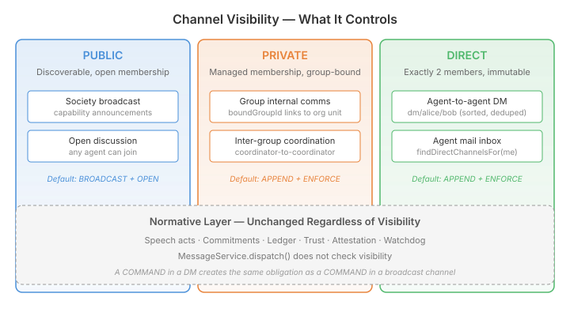

# When Agents Need Mailboxes

Multi-agent systems talk a lot about coordination — task delegation, consensus, negotiation protocols. What they talk about less is the mundane infrastructure underneath: how does agent A send agent B a private message? How does a working group get a shared channel that only its members can see? How does a society-wide announcement reach everyone without flooding every agent's inbox?

These aren't research questions. They're the plumbing you need the moment agents start forming groups, splitting into teams, and coordinating across organisational boundaries. And the answer matters, because getting it wrong means either no access control (every agent sees everything) or a bespoke authorisation system bolted onto every channel interaction.

## The Gap

Qhorus already had the mechanical ingredients. Channels have participation policies (OPEN, AUTO_REGISTER, ENFORCE) that control who can join. They have allowed-writer lists that control who can post. They have membership tracking with roles (PARTICIPANT, OBSERVER, MODERATOR). All the access control knobs exist.

What was missing was *intent*. A channel with `participationPolicy=ENFORCE` and two members looks exactly like a channel with `participationPolicy=ENFORCE` and twenty members. The infrastructure can't distinguish a private DM from a group workspace from a public broadcast — they're all just "channels with settings." That distinction matters when you're building a self-organising agent society that needs to create channels on the fly for groups, DMs, and broadcasts, each with different lifecycle rules.

## Visibility as Organisational Intent

The solution is a `ChannelVisibility` enum — `PUBLIC`, `PRIVATE`, `DIRECT` — that declares what a channel *is for*, separate from how its access control is configured.

<figure>

</figure>

This distinction is important: visibility controls *organisational semantics* — discoverability, membership lifecycle, creation patterns. It does not control the message dispatch pipeline. A COMMAND sent in a DIRECT channel creates exactly the same obligation, ledger entry, and attestation chain as a COMMAND sent in a PUBLIC broadcast. The normative stack is visibility-blind.

This mirrors how messaging platforms like Slack and Discord use the word "visibility" — it describes channel discoverability and membership management intent, not message-level access control. A public Slack channel isn't "public" because its messages are readable by the internet. It's public because anyone in the workspace can find it and join it.

## DIRECT Channels — The Agent Mailbox

The most immediately useful pattern is DIRECT: exactly two members, immutable membership, deterministic identity.

```java
var result = visibilityManager.getOrCreateDirect("researcher", "coordinator");
// → channel name: dm/coordinator/researcher (sorted alphabetically)
// → both agents joined as PARTICIPANT
// → calling again with reversed args returns the same channel
```

The name is deterministic — sort the two participant IDs alphabetically, concatenate with `dm/` prefix. `getOrCreateDirect("bob", "alice")` and `getOrCreateDirect("alice", "bob")` produce the same channel name (`dm/alice/bob`), so the deduplication is inherent in the naming scheme.

Membership is locked at creation. The infrastructure enforces this — `join()` rejects any attempt to add a third member, `leave()` rejects entirely. These guards live in the membership service, so they apply regardless of how the join is triggered: MCP tool, REST API, gateway auto-join, internal service call.

For an agent checking its inbox, `findDirectChannelsFor("researcher")` queries membership by participant ID and filters to DIRECT visibility. Combined with the existing `getUnreadCounts()`, an agent has the primitives to build an inbox view: "I have 3 unread messages from coordinator, 1 from analyst."

## Group Channels — Organisational Binding

When agents form working groups — a research team, a review panel, a negotiation caucus — they need a shared channel that's bound to the group's lifecycle:

```java
Channel ch = visibilityManager.createGroupChannel(
    groupId,           // UUID from the org unit registry
    "research-team",   // becomes channel name: group/research-team
    List.of("alice", "bob", "carol"),
    "alice"            // coordinator → MODERATOR role
);
```

The channel is PRIVATE by default (membership managed explicitly, participation enforced). The `boundGroupId` field links the channel to the organisational unit that created it — a first-class indexed field, not a metadata string. `findGroupChannel(groupId)` resolves in a single indexed query.

The binding is strict: if a channel named `group/research-team` already exists but is bound to a different group ID, the creation throws rather than silently returning the wrong channel. Same group ID returns the existing channel (idempotent).

Membership synchronisation — adding members when agents join the group, removing them when they leave, transferring MODERATOR role when the coordinator changes — is the caller's responsibility. Qhorus provides the membership primitives; the society layer orchestrates them. This is a deliberate boundary: Qhorus is a communication primitive, not an authorisation layer. It stores the MODERATOR role but doesn't enforce "only MODERATOR can add members" — that policy belongs in the organisational layer that has the context to make access decisions.

## Defaults That Steer Without Constraining

Each visibility type carries creation-time defaults:

| Visibility | Default Semantic | Default Participation |
|---|---|---|
| PUBLIC | BROADCAST | OPEN |
| PRIVATE | APPEND | ENFORCE |
| DIRECT | APPEND | ENFORCE |

These defaults are applied when the caller sets a visibility but doesn't explicitly set semantic or participation policy. A caller that *does* set them overrides the defaults — a PRIVATE channel with BARRIER semantic is perfectly valid (a consensus-requiring group decision channel). The defaults steer callers toward the sensible pairing without constraining legitimate alternatives.

Existing channels that predate the feature have `visibility = null`. No retroactive assignment, no behavioural change. Null means "not classified" — distinct from PUBLIC, which means "explicitly intended for open membership." This matters in mixed deployments where legacy channels coexist with visibility-typed ones.

## What This Unlocks

The self-organising agent society needs typed communication for its social structure:

- **Group internal comms** → PRIVATE channel bound to the group's org unit ID, created when the group forms
- **Agent-to-agent DM** → DIRECT channel, created on demand
- **Inter-group collaboration** → PRIVATE channel between coordinators
- **Society-wide announcements** → PUBLIC channel with BROADCAST semantic

Each of these was *possible* before — you could manually create a channel, set its participation policy, manage its membership. What visibility adds is the *intent layer* that lets the society lifecycle manager create the right kind of channel with a single call, and lets agents query "show me my DMs" or "find the channel for this group" without scanning every channel's configuration.

The normative layer doesn't change. Every message in every channel — PUBLIC broadcast, PRIVATE group, DIRECT DM — still creates a ledger entry, still tracks commitments, still evaluates watchdog conditions. A DM loop between two agents triggers the same `LOOP_DETECTED` alert as a loop in a broadcast channel. Governance follows the message, not the channel shape.
