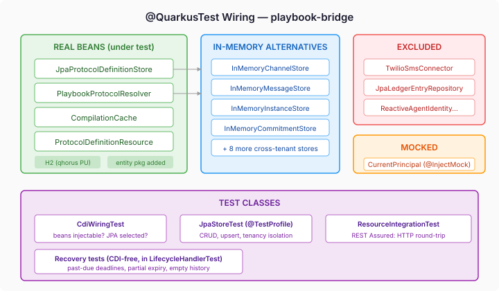

# Testing the Bridge from Outside

*Continues from [Three Gaps, One Pass](2026-11-23-mdp01-three-gaps-one-pass.md).*

The playbook-bridge module landed with CDI-free unit tests covering every code path. Every bean tested in isolation — fields set directly, dependencies stubbed with lambdas and in-memory implementations, no CDI container anywhere. The tests ran in milliseconds. They also couldn't tell you whether the module actually assembled inside a Quarkus application.

That's the gap CDI-free tests can't close. A `@FunctionalInterface` SPI like `PlaybookExecutor` might have the right signature in a unit test but fail to resolve as a CDI bean because `PlaybookRunnerCore` — its upstream dependency — isn't on the classpath at augmentation time. A `JpaProtocolDefinitionStore` might pass every CRUD assertion with an in-memory stand-in, but the real JPA store needs an entity package registered in the named persistence unit, and if `io.casehub.qhorus.playbook.bridge` isn't in that package list, Hibernate silently ignores the entity. Everything compiles. Nothing works.

## The optional module problem

Qhorus has a dozen optional modules — connector-backend, slack-channel, webhook-observer, playbook-bridge. Each activates by classpath presence, declares its own JPA entities, and injects beans from the runtime module. Testing one of these modules under `@QuarkusTest` means bringing up the full container, which means solving a dependency puzzle: the runtime module's stores need in-memory alternatives (the JPA implementations need a real database, and you don't want that coupling in another module's tests), the ledger library beans need a default datasource, and the entity packages need extending to include the optional module's own entities.



The connector-backend module had already solved this. Its `application.properties` declares InMemory store alternatives via `selected-alternatives`, configures dual H2 datasources (one for the default PU, one for the named qhorus PU), and excludes credential-bearing connectors that would fail CDI validation. The playbook-bridge follows the same pattern — the interesting difference is that the bridge's own store is JPA-backed, so it can't be replaced with an in-memory alternative. It's the bean under test.

The `@TestProfile` for the JPA store tests creates a dedicated H2 database (`playbook_jpa_store`) separate from the default test database. Cross-test isolation comes from `UUID.randomUUID()` per test, not from transaction rollback — the `@TestProfile` triggers a Quarkus restart, which is the right tradeoff for verifying the actual JPA wiring.

## The parser that wasn't

The other fix was quieter but arguably more important. `PlaybookProtocolLifecycleHandler.parseDeadlines()` extracted deadline durations from YAML using line splitting:

```java
String[] lines = yamlContent.substring(idx).split("\n");
for (int i = 1; i < lines.length; i++) {
    String line = lines[i];
    if (!line.startsWith("  ") && !line.startsWith("\t")) break;
    // ...
}
```

This breaks on 4-space indentation. It breaks on inline comments (`timeout: PT5M  # response deadline`). It treats any top-level `deadlines:` substring as the section — including one nested three levels deep in a different part of the document. And the same fragile logic was duplicated in `ProtocolDefinitionResource.validateYaml()`.

snakeyaml was already on the classpath — transitive through `casehub-platform-yaml-step-runtime` via `jackson-dataformat-yaml`. The replacement is straightforward: `new Yaml().load(yamlContent)`, extract the `deadlines` key from the resulting map, convert values to strings. The validator now delegates to `parseDeadlines()` instead of reimplementing it. Malformed YAML that would have silently produced empty results now gets caught and logged.

The lesson isn't "use a real parser" — that's obvious. It's that `parseDeadlines()` passed all its tests with the hand-rolled implementation because every test used 2-space indentation. The tests validated the happy path of the implementation, not the contract of the interface. Adding tests for 4-space indent, inline comments, and nested keys made the parser's fragility visible — and at that point, the right fix was to stop parsing YAML by hand.
