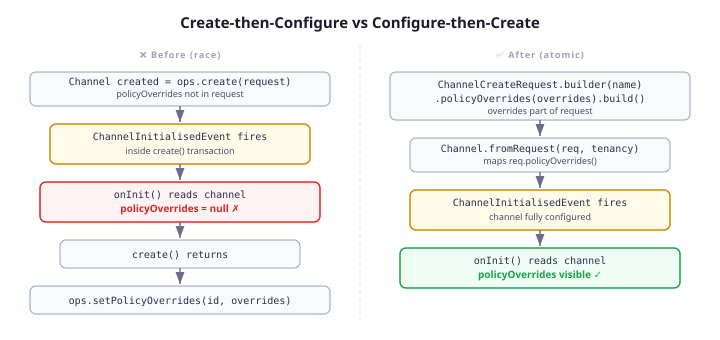

# The Configuration That Arrived Too Late

Qhorus channels fire a `ChannelInitialisedEvent` during creation. The event is synchronous — it runs inside the create transaction, before `create()` returns to its caller. Any `ProtocolLifecycleHandler` observing that event can read the channel and configure protocol state based on what it sees.

The problem: `policyOverrides` wasn't part of the channel at that point. The creation flow looked like this:

```java
Channel created = ops.create(request);
// ↑ ChannelInitialisedEvent fires HERE, inside create()

ops.setPolicyOverrides(created.id(), spec.policyOverrides());
// ↑ too late — handlers already ran
```

By the time `setPolicyOverrides()` runs, the init event has already fired. Any lifecycle handler that read the channel during init saw null overrides. The channel was born half-configured.



This is the create-then-configure anti-pattern. It works fine when configuration is consumed lazily — a handler that reads overrides at dispatch time sees the final state. But it fails when configuration is consumed eagerly, at init time, before the caller gets control back. Synchronous events during creation create a window where the object exists but isn't fully configured. Anything that observes the object during that window sees an incomplete state.

The fix is obvious once the pattern is named: include everything in the creation request. `ChannelCreateRequest` gained a `policyOverrides` field. `Channel.fromRequest()` maps it. The channel is fully configured before the event fires. No window, no race.

```java
var request = ChannelCreateRequest.builder(spec.name())
        .policyOverrides(spec.policyOverrides())
        // ...
        .build();
Channel created = ops.create(request);
// event fires with overrides already in place
```

The change also added `policyOverrides` to `QhorusConfig.ChannelConfig`, so YAML-declared channels can specify overrides at boot time with drift detection for existing channels. The pattern matches how `metadata`, `protocols`, and `enforcementMode` already flow through — all set at creation time, all visible to init handlers.

The interesting thing is how long this was latent. The `setPolicyOverrides()` API has existed since the policy override system was built. No handler was reading overrides at init time — until the playbook-bridge module arrived and needed protocol parameters during `onInit()` to configure playbook execution. The race only surfaces when a consumer adds an eager init-time reader. By then the API shape is established and the post-create pattern is copied from existing code.

The broader lesson: if an object fires lifecycle events during construction, every piece of state that event handlers might need must be part of the construction parameters. Post-construction setters are fine for lazy consumers but invisible to eager ones. The two-phase "create then configure" pattern is safe only when no observer sits between the two phases — and synchronous events guarantee that observers do.
