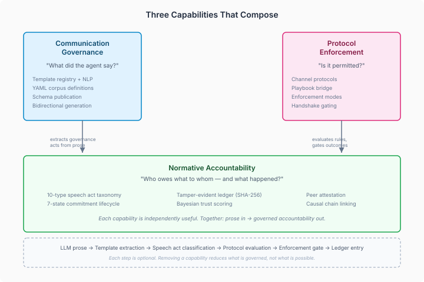

# Governance Needs Perception

The normative layer has always argued that accountability cannot be retrofitted. The commitment lifecycle, the tamper-evident ledger, the trust model — these track what agents owe each other and whether they delivered. That argument holds. But it has a blind spot.

An agent writes "I approved this architecture because it handles failover." Without mechanical extraction, that approval is a prose string. The normative layer records a DONE message, timestamps it, links it causally. But it does not know the message is an approval, does not know the subject is "architecture", does not know the rationale is "handles failover." A human reading the ledger knows. The infrastructure does not.

This is the perception gap. The normative layer governs at the message-type level — COMMAND creates obligation, DONE fulfills it, DECLINE closes it with reason. But governance acts happen at the content level. Approvals, votes, escalations, delegations with structured reasons — these are embedded in natural language that the commitment lifecycle never examines.

## Three capabilities, not one stack

The original normative docs told the story as a four-layer stack: speech act theory at the bottom, deontic logic above it, defeasible reasoning above that, social commitment semantics at the top. Each layer depended on the one below. It was a vertical argument — theoretically sound, but it locked the narrative into a mandatory bottom-up structure that left no room for the perception layer or the enforcement pipeline that now exist.

The revised framing is orthogonal composition. Three capabilities, each independently useful, each addressing a different gap:

- **Communication governance** — template registry with NLP extraction. Parses agent prose into structured governance acts with typed fields. Schema publication tells agents what sentence shapes the protocol expects. Bidirectional: extracts fields from prose and generates conformant prose from fields.

- **Normative accountability** — the existing commitment lifecycle, ledger, and trust model. Tracks obligations, records them tamper-evidently, derives trust from behaviour.

- **Protocol enforcement** — channel protocols, playbook bridge, enforcement modes. Evaluates governance rules at dispatch time. Gates outcomes on participant agreement over extracted fields — not message count.

Each works alone. A channel with only normative accountability tracks obligations via typed messages — no templates needed. A channel with communication governance parses governance acts from prose — no commitment tracking needed. The composition is additive and opt-in. Remove a capability and you reduce what is governed, not what is possible.

## The join: handshake gating

The composition produces something none of the capabilities can produce alone. Take a governed architecture review: three agents must vote. The protocol requires all participants to weigh in before the outcome takes effect.

Without communication governance, the protocol counts messages. "Looks good to me" counts as a vote. With it, the protocol evaluates template-extracted fields. A vote counts when the extraction confirms a structurally matched decision value — approve, reject, or abstain. The outcome is determined by the extracted fields, not by counting messages.

This is handshake gating — governed outcomes gated on participant agreement over structured extractions. It is the natural join of perception and enforcement. Without it, protocol enforcement is metadata-only. With it, enforcement is content-aware.

## The accountability argument

An adversarial review pushed back on the composition model: most agent communication is reasoning and discussion, not governance acts. Template matching governs 5-10% of messages. The other 90% flows through ungoverned.

The right response is not "template matching is a precision instrument for the governed 5%." The right response is that the ungoverned 90% is the problem. At some point, agent conversation must result in something actionable — a function call, an event, a normalised structure — or the conversation produces no accountability at all. In regulated environments, that is dangerous.

The template registry is how conversation becomes accountability. Agents converse freely, but consequential acts — approvals, votes, escalations, delegations — must be robust and unambiguous. The governed outcome is formulaic by design, not despite it. A vote should sound like a vote.

## What changed in the docs

Four documents revised across +933/-400 lines. The primary doc — `normative-layer.md` — restructured around the three-capability composition. The four-layer stack diagram replaced by a composition diagram. Insurance claim and production incident examples extended with template matching annotations. A new Scenario 3 (governed architecture review) demonstrates the full composition loop — all three capabilities load-bearing, handshake gating producing a collective outcome from individually extracted votes.

The supporting docs follow: navigation index updated, critique revised with the perception layer addressed, and a new developer guide section on template-based communication governance covering YAML corpus, NLP extraction, schema publication, enforcement wiring, and anti-patterns.

Three platform issues filed from the adversarial review: atomic namespace update (#972), NearMiss guided rejection (#973), and corpus quality testing tooling (#974). These are implementation gaps worth addressing, not design flaws — the composition model itself held up under scrutiny.

## What it opens up

The YAML corpus format (platform #969) is the next concrete step. It defines how governance vocabularies are declared — the templates that the extraction pipeline compiles and matches against. The docs now frame what the corpus format needs to deliver. After that, the `match` playbook step (#970) connects corpus-defined templates to playbook execution, and the consumer migration (#961) consolidates the fragmented matching infrastructure into the unified registry.

On the qhorus side, speech act verification (template matching against declared MessageType) and content-level handshake gating both need implementation work. The docs describe these capabilities architecturally; the code implements the foundation they will build on.

The perception gap was always there — we just did not name it until the template registry made it visible. The normative layer tracked accountability at the type level. Communication governance extends it to the content level. The composition closes the loop from natural language to governed, auditable action.
